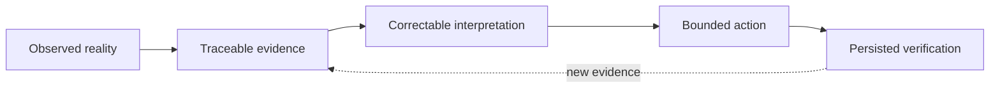

# Dustin Braun
## Data Validation Lead building evidence-grounded systems
### Quality engineering · observability · AI evaluation · bounded automation

### I build software that preserves the difference between what happened, what a model inferred, and what actually changed.

---

## What I build

My work began in test automation and grew into a broader engineering question:

> Can a system make useful judgments without confusing evidence, interpretation, and action?

I build systems that observe real environments, preserve provenance, evaluate model
behavior, and verify consequential actions against persisted state. The common thread
is trust: claims should have evidence, interpretations should remain correctable, and
software should never report success merely because it intended to do something.

### Current systems work

- **Signal & Noise** — correlates observable reality with telemetry and system claims,
  producing traceable evidence instead of opaque pass/fail output.
- **Life OS** — a private, local-first system for human evidence, derived memory,
  model-assisted inference, and bounded actions with verification receipts.
- **Evaluation and AgentOps tooling** — exercises assistants as operating systems:
  retrieval quality, capability selection, mutation verification, and behavioral regressions.

Much of the current work is private by design because it operates on personal evidence.
The public projects below show the engineering foundations: data validation, video analysis,
browser automation, API contracts, performance, security, and CI.

---

## The through-line

The implementation changes by domain. The boundary does not: observation is not
inference, inference is not authority, and an attempted action is not a completed one.

---

## Selected public work

### [Signal & Noise — Screen-to-Events](https://github.com/jptrp/signal-noise-screen2events)

Correlates what appeared on a device screen with what application telemetry claims
happened. It derives independent timelines from video and telemetry, aligns them, and
produces mismatch reports with timestamps and screenshot evidence.

**Why it matters:** telemetry is useful, but it is still a claim. The user-visible
experience provides an independent source against which that claim can be tested.

`Python` · `Pydantic` · `OpenCV` · `state machines` · `timeline correlation`

### [Chrome DevTools Pattern Detector](https://github.com/jptrp/chrome-devtools-pattern-detector)

An MCP server that turns browser telemetry into diagnoses: repeated console failures,
slow endpoints, broken resources, performance regressions, and heap-growth patterns.
Each result includes counts, timestamps, and a concrete next step.

**Why it matters:** raw observability creates more data. Useful observability reduces
the distance between a signal and a justified action.

`TypeScript` · `MCP` · `Chrome DevTools` · `performance` · `diagnostics`

### [Video Data Quality Lab](https://github.com/jptrp/video-data-quality-lab)

A production-style pipeline for simulated streaming events: ETL, dimensional models,
data contracts, SQL and Python checks, anomaly detection, quality KPIs, and CI artifacts.

**Why it matters:** quality is strongest when it is designed into every transition,
not added as a final inspection step.

`Python` · `DuckDB` · `Pydantic` · `Pandera` · `FastAPI` · `GitHub Actions`

### [Website Functional Testing Agent](https://github.com/jptrp/website-functional-testing-agent)

A browser-driven agent that executes a deterministic ten-step smoke test and emits
both machine-readable and human-readable results with meaningful exit codes.

**Why it matters:** autonomy becomes trustworthy when its scope, observations, and
success conditions are explicit.

`Playwright` · `JavaScript` · `structured reports` · `CI`

---

## Engineering foundations

The current systems work grew from years of hands-on quality engineering across UI,
API, data, performance, security, and delivery pipelines.

| Area | Public evidence |
|---|---|
| Browser automation | [WebdriverIO](https://github.com/jptrp/saucedemo-wdio-automation) · [Playwright](https://github.com/jptrp/saucedemo-playwright) · [Cypress](https://github.com/jptrp/cypress-ui-saucedemo-automation) |
| API and contracts | [Postman/Newman](https://github.com/jptrp/saucedemo-api-testing-postman) · [Playwright API](https://github.com/jptrp/playwright-api-petstore-automation) |
| Performance and security | [k6 + OWASP ZAP](https://github.com/jptrp/k6-zap-perfsec-automation) |
| Enterprise test strategy | [ERP Test Automation](https://github.com/jptrp/cypress-erp-test-automation) |

---

## How I work

- **Evidence before confidence.** A useful claim should be traceable to what supports it.
- **Interpretation stays correctable.** Model output can be valuable without becoming fact.
- **Verify the mutation.** Software may claim an action only after persisted state confirms it.
- **Automation should remove orchestration.** A system should reduce human coordination,
  not create another machine the human must constantly operate.
- **Reality gets veto power.** When the model and the observed world disagree, inspect the world.

---

## Working stack

**Languages:** Python, TypeScript, JavaScript 
**Systems:** React, Vite, Next.js, Node.js, FastAPI, REST, MCP 
**Evidence and data:** Pydantic, DuckDB, Pandera, OpenCV, JSONL, state machines 
**Quality:** Playwright, Cypress, WebdriverIO, Postman/Newman, k6, OWASP ZAP 
**Operations:** GitHub Actions, Docker, Vercel, AWS, OpenSearch

---

## Contact

**Dustin Braun** 
Castle Rock, Colorado 
[Email](mailto:jptrp@icloud.com) · [LinkedIn](https://www.linkedin.com/in/dustinbrauntesting/) · [GitHub](https://github.com/jptrp)

---

*Quality engineering for systems that observe, infer, and act.*

